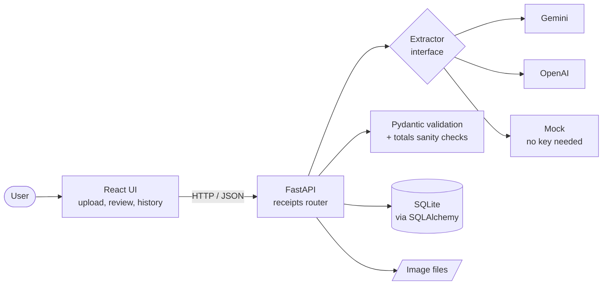

# Receipt Scanner

Upload a photo of a receipt and get clean, structured data: merchant, date, line items, tax and total. Review and correct the result in the browser, keep a searchable history, and export everything to CSV.

## Features

- **AI extraction**: a vision model (Google Gemini or OpenAI) reads the receipt and returns JSON.
- **Schema validation**: every model reply is validated with Pydantic before it is saved.
- **Sanity checks**: receipts whose items, tax and total do not add up are flagged for review.
- **Review and edit**: fix any field next to the original image.
- **History, search, summary and CSV export**.
- **Mock mode**: runs with no API key, using sample data. The tests use it too.
- **Sample receipts**: a new database starts with five example receipts so the dashboard is not empty. They are labelled "Sample" and can be removed with one click.

## Tech stack

| Layer    | Technology                                   |
|----------|----------------------------------------------|
| Backend  | Python, FastAPI, SQLAlchemy 2, Pydantic      |
| Database | SQLite (any SQLAlchemy URL, e.g. PostgreSQL) |
| AI       | Google Gemini API, OpenAI API (vision)       |
| Frontend | React, Vite, plain CSS                       |
| Quality  | PyTest                                       |
| Deploy   | Docker (single image)                        |

## Architecture



The extractor is an interface (`app/extractors/base.py`), so another provider can be added without touching the API code. Every model reply is validated before it is saved, and receipts whose numbers do not add up are flagged for review.

See [docs/ARCHITECTURE.md](docs/ARCHITECTURE.md) for the request flow, data model and design decisions.

## Project structure

```
app/
  main.py              FastAPI app, CORS, static frontend
  config.py            Settings from .env
  database.py          Engine and session
  models.py            SQLAlchemy tables
  schemas.py           Pydantic request/response models
  dependencies.py      Chooses the extractor
  routers/receipts.py  API endpoints
  extractors/          Gemini, OpenAI and mock extractors
  services/validation.py  Totals sanity checks
  services/samples.py  Sample receipts for a new database
frontend/              React app (Vite)
tests/                 PyTest suite
```

## Run it locally

Requirements: Python 3.11+, Node.js 18+.

**1. Backend** (first terminal, from the project folder)

```bash
python -m venv .venv
.venv\Scripts\activate          # macOS/Linux: source .venv/bin/activate
pip install -r requirements.txt
copy .env.example .env          # macOS/Linux: cp .env.example .env
uvicorn app.main:app --reload
```

The API runs at http://127.0.0.1:8000 and its interactive docs at http://127.0.0.1:8000/docs.

**2. Frontend** (second terminal)

```bash
cd frontend
npm install
npm run dev
```

Open http://localhost:5173.

### Sample receipts

The first time the backend starts, it adds five example receipts so there is something to look at. They carry a "Sample" label. Delete them one at a time, or use **Remove samples** in the note at the top of the page. Once removed they do not come back.

To start with an empty dashboard instead, set `SEED_SAMPLE_DATA=false` in `.env` before the first run.

### Use real AI extraction

The app starts in mock mode. To read real receipts, edit `.env` and restart the backend.

Google Gemini (free tier, key from https://aistudio.google.com/apikey):

```
EXTRACTOR=gemini
GEMINI_API_KEY=...
```

OpenAI:

```
EXTRACTOR=openai
OPENAI_API_KEY=sk-...
```

`.env` is git-ignored, so keys are never committed.

## Tests

```bash
pytest
```

## Docker

```bash
docker build -t receipt-scanner .
docker run -p 8000:8000 --env-file .env receipt-scanner
```

Open http://localhost:8000. The API serves the built frontend.

## API

| Method | Path                            | Description                     |
|--------|---------------------------------|---------------------------------|
| POST   | `/api/v1/receipts/scan`         | Upload an image and extract it  |
| GET    | `/api/v1/receipts`              | List (`q`, `limit`, `offset`)   |
| GET    | `/api/v1/receipts/{id}`         | Get one receipt                 |
| PUT    | `/api/v1/receipts/{id}`         | Save corrections                |
| DELETE | `/api/v1/receipts/{id}`         | Delete a receipt and its image  |
| GET    | `/api/v1/receipts/{id}/image`   | Original image                  |
| DELETE | `/api/v1/receipts/samples`      | Remove the sample receipts      |
| GET    | `/api/v1/receipts/summary`      | Spending totals by category     |
| GET    | `/api/v1/receipts/export.csv`   | CSV export                      |
| GET    | `/api/health`                   | Health check                    |
