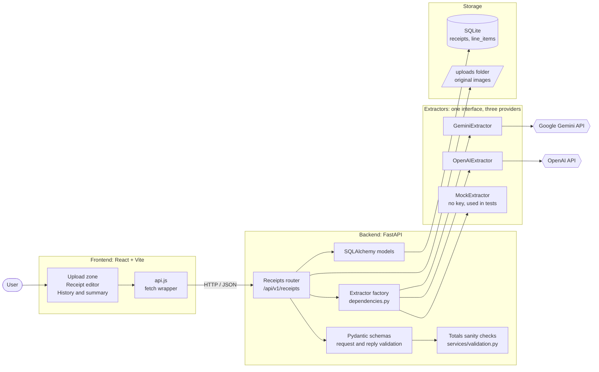
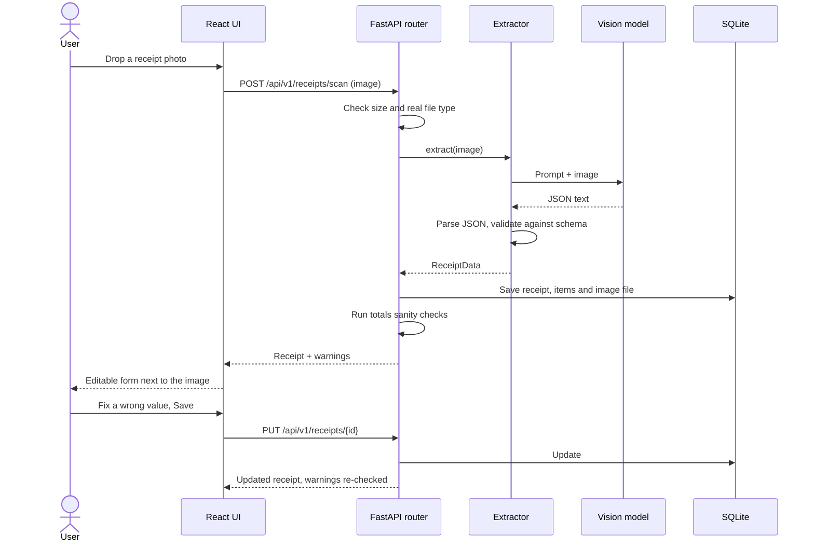
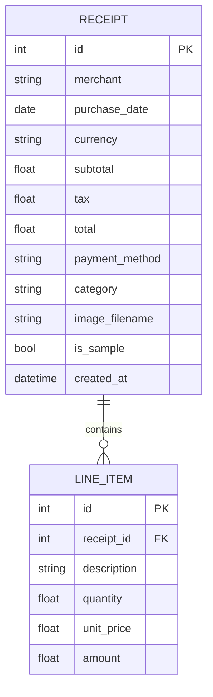

# Architecture

This document explains how the Receipt Scanner is put together: the main components, what happens when a receipt is scanned, how the data is stored and where each piece lives in the code.

## System overview



## What happens when a receipt is scanned



## Data model



## Code map

```
receipt-scanner/
├── app/                        Backend (FastAPI)
│   ├── main.py                 App setup, CORS, serves the built frontend
│   ├── config.py               Settings read from .env
│   ├── database.py             Engine and per-request session
│   ├── models.py               SQLAlchemy tables
│   ├── schemas.py              Pydantic request and response models
│   ├── dependencies.py         Chooses the extractor from settings
│   ├── routers/
│   │   └── receipts.py         All /api/v1/receipts endpoints
│   ├── extractors/
│   │   ├── base.py             Extractor interface and error type
│   │   ├── prompt.py           Shared prompt and reply parsing
│   │   ├── gemini_extractor.py
│   │   ├── openai_extractor.py
│   │   └── mock_extractor.py
│   └── services/
│       ├── validation.py       Totals sanity checks
│       └── samples.py          Sample receipts for a new database
├── frontend/                   Frontend (React + Vite)
│   └── src/
│       ├── App.jsx             Page state and layout
│       ├── api.js              Calls to the backend
│       ├── format.js           Money and date formatting
│       ├── styles.css
│       └── components/         UploadZone, ReceiptEditor, HistoryList, SummaryBar
├── tests/                      PyTest suite (runs in mock mode, no network)
├── Dockerfile                  One image: builds the frontend, serves it from FastAPI
└── .env.example                Settings template
```

## Design decisions

| Decision | Why |
|----------|-----|
| Extractors share one interface | A new AI provider is one new file; the router never changes. |
| Mock extractor | The project runs and the tests pass with no API key and no cost. |
| Model output is never trusted | Every reply is parsed and validated with Pydantic, then the totals are cross-checked. Problems become warnings for a person to review, not silent bad data. |
| File type detected from the bytes | The upload's claimed content type can be wrong or forged. |
| Images saved under random names | User-supplied filenames never reach the disk. |
| Database URL comes from settings | SQLite locally; PostgreSQL in production with no code change. |
| Samples are added only when the database is created | A first-time visitor sees a working dashboard, and samples stay gone once deleted. |
| FastAPI serves the built frontend | Deployment is a single Docker image. |
